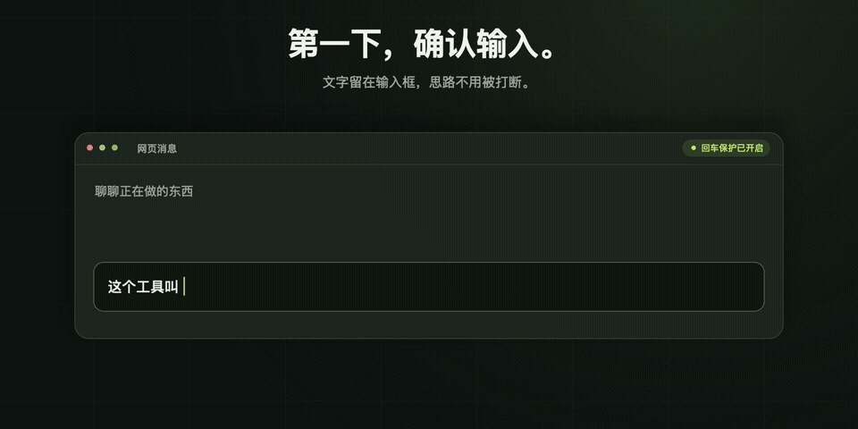

  <picture>
    <source media="(prefers-color-scheme: dark)" srcset="docs/assets/logo-dark.svg">
    
  </picture>

<strong>还在选词，别急着发送。</strong>

macOS 菜单栏工具 · 无需浏览器扩展

---

候选词还在，按回车只是想确认输入，网页却直接搜索了，或者把没写完的消息发了出去。

**StillTyping!!! 在输入法组词时阻止网页误提交，让这次回车只用来确认输入。** 文字确认之后，再按回车就照常搜索或发送。

它面向拼音、五笔等带候选词、需要确认上屏的输入法。比如用中文输入法打了一段英文，想按回车保留原文、接着往下写，这也是它要解决的场景。

## 按原来的习惯打字

  <picture>
    <source media="(prefers-reduced-motion: reduce)" srcset="docs/assets/usage.png">
    
  </picture>

操作示意：回车确认输入，下一次回车正常发送。

输入法原本怎样确认文字，就仍然怎样确认。空格选词、数字选词、英文直输，以及 Shift / ⌘ / ⌃ / ⌥ + 回车等快捷键，都保留原有行为。

应用打开后默认开启保护，可以随时从菜单栏暂停。界面支持简体中文、英文和系统深浅色，也可以隐藏程序坞图标。在「概览 → 启动」中开启「登录时启动」，登录 Mac 后会自动打开应用。

## 下载安装

需要 **macOS 14.0 或更新版本**。

1. 前往本仓库的 **Releases** 页面，下载应用压缩包。
2. 解压后，将 **StillTyping!!!** 拖入「应用程序」文件夹。
3. 打开应用，在菜单栏中找到 StillTyping!!!。

## 首次设置

1. 打开浏览器，在开发者菜单或相关设置中开启「允许来自 Apple Events 的 JavaScript」。
2. 在 StillTyping!!! 的「浏览器」页点击「连接」，允许系统弹出的自动化授权。
3. 应用默认开启「回车保护」，连接成功后回到网页继续输入。

首次连接后，应用会记住所选浏览器。浏览器重新打开或临时断连时，会自动尝试重连，无需每次返回 App 点击「连接」。保护总开关仍由你手动控制。

各浏览器的设置入口

- **Safari**：设置 → 开发者 → 允许来自 Apple Events 的 JavaScript。若未显示开发者选项，先在高级设置中显示网页开发者功能。
- **Chrome、Edge、Brave、Vivaldi、Opera**：在浏览器的开发者菜单中允许来自 Apple Events 的 JavaScript。
- **Arc**：设置 → 高级 → 允许来自 Apple Events 的 JavaScript。

应用内有「输入测试」页，可以先用自己的输入法试一下：第一次回车确认文字，松开后再按一次，才增加提交次数。

## 兼容性

目前已接入 **Safari、Chrome、Microsoft Edge、Arc、Brave、Vivaldi、Opera**。保护作用于已连接浏览器当前标签页的顶层网页；新开、刷新或切换网页后，可能有约 1 秒的安装间隙。

项目处于开发验证阶段，以 macOS 系统拼音为首轮适配目标。真实输入法与网页的端到端验收尚未完成；其他中文输入法及日文、韩文输入法仍需分别验证。已知限制与验证状态见 [兼容性说明](docs/COMPATIBILITY.md)。

## 隐私

所有处理都在本机完成。不读取输入框内容、候选词、组词文本或剪贴板，不记录按键历史。使用浏览器自动化授权，无需辅助功能或全局键盘监听权限。

## 反馈与开发

遇到误提交或确认异常，欢迎提 Issue，带上输入法、浏览器、macOS 版本、网站和复现步骤。

构建、测试与源码结构见 [开发文档](docs/DEVELOPMENT.md)。
